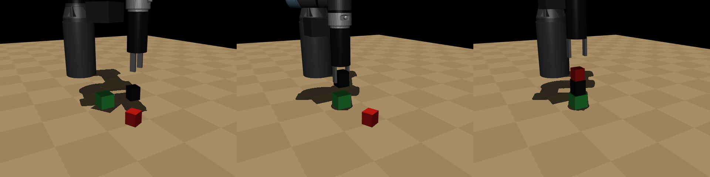

# ur7e-block-tower: stacking blocks with a UR7e, from MuJoCo to the real arm

[Tower results](results) · [ROS 2 package for the lab arm](ros2/tower_ros)



A UR7e with a Robotiq Hand-E stacks the three blocks of the EECS 106A lab cell at UC Berkeley into one tower: black on green, then red on black. The task is built in MuJoCo with the lab geometry and the measured blocks, and the same scripted stack runs on the real arm through ROS 2. On the measured blocks, the scripted stack builds 91.5 % of 200 towers under camera error; a PPO policy fine-tuned on top of it reaches 83 %.

## Method

- **Perception.** Block poses come from a camera estimate with error (3 mm, 4 deg), replaced by a wrist-camera close-up (1 mm, 1.5 deg) once the gripper is above the block. The green block is wider than the 50 mm Hand-E stroke, so it stays in place as the base.
- **Scripted stack** ([`tower_scripted.py`](pensig/tower_scripted.py)): pick and carry, going down only on the wrist estimate, then a touchdown at 6 cm/s and 1 cm/s over the last 12 mm that stops on the wrist force, like `moveUntilContact`.
- **Learning** ([`residual.py`](pensig/residual.py), `ResidualTowerEnv`): PPO (Stable-Baselines3) learns a bounded correction on top of the script, with a potential-based reward and the wrist force in the observation. Damped least-squares IK turns the TCP target into joint commands at 20 Hz, and a protective stop ends the episode when the gripper or a block presses too hard, as on the real arm.
- **Real arm** ([`ros2/tower_ros`](ros2/tower_ros)): the same stack on the lab UR7e with MoveIt IK, the wrist RealSense and a touchdown on the wrist force-torque sensor. `tower_policy` runs the PPO policy exported to numpy.

## Results

200 full towers under camera error. A placement counts within 8 mm and 10 deg, released and cleared.

Measured lab blocks (green 50 mm, black 80 mm, red 30 mm high):

| | Full tower | Black on green | Red on black | Placement error |
|---|---|---|---|---|
| Scripted stack | **91.5 %** | 93.5 % | 97.9 % | 1.6 mm |
| PPO residual, fine-tuned 500k steps on these sizes | 83 % | 90.5 % | 91.7 % | 2.0 mm |
| PPO residual, before fine-tuning | 55 % | 81.5 % | 67.5 % | 2.1 mm |

Block sizes estimated from a photo, and what the wrist close-up brings:

| | Full tower | Black on green | Red on black | Placement error |
|---|---|---|---|---|
| Scripted stack | **93 %** | 96 % | 96.9 % | 1.6 mm |
| Scripted stack, first estimate only | 52 % | 66 % | 78.8 % | 4.0 mm |
| Scripted stack, exact poses | 98.5 % | 98.5 % | 100 % | 0.3 mm |

The gain came from information, not training: without the close-up, most failures were a finger landing on top of the black block or a block set down off center, from a camera error the policy could not see. On the real UR7e, black on green worked on the first run in step mode, stopping at 3.1 N on contact.

Source: the `tower_*.json` files in [`results/`](results).

## Install and run

Python 3.10 or newer and MuJoCo 3.2 or newer. The UR5e model (same kinematics as the UR7e) is downloaded from MuJoCo Menagerie, not redistributed.

```bash
python -m venv .venv && .venv/Scripts/activate     # source .venv/bin/activate on Linux
pip install -e ".[dev]"
python scripts/fetch_assets.py
python -m pytest -q
python scripts/evaluate_tower.py --scripted --episodes 200 --block-sizes 0.05 0.05 0.04 0.08 0.035 0.03
python scripts/train.py --task tower --residual --block-sizes 0.05 0.05 0.04 0.08 0.035 0.03 --timesteps 4000000 --out runs/tower
python scripts/evaluate_tower.py --residual --policy runs/tower/final_model.zip --episodes 200 --block-sizes 0.05 0.05 0.04 0.08 0.035 0.03
```

On the lab arm: [`ros2/tower_ros/README.md`](ros2/tower_ros/README.md).

## Code structure

| Path | Role |
|---|---|
| [`scene.py`](pensig/scene.py) | UR5e from Menagerie, Hand-E with the lab fingers (fingertips 16 cm below the flange), wrist camera, lab pedestal |
| [`tower.py`](pensig/tower.py) | Gymnasium env: blocks, camera and wrist estimates, wrist force, reward, protective stop |
| [`tower_scripted.py`](pensig/tower_scripted.py) | scripted pick, carry and force-stopped touchdown |
| [`ik.py`](pensig/ik.py), [`residual.py`](pensig/residual.py) | damped least-squares IK; env where PPO learns a correction on the script |
| [`ros2/tower_ros`](ros2/tower_ros) | perception, scripted tower and policy nodes for the real UR7e |
| [`scripts/`](scripts) | train, evaluate, export the policy, world-model planning, Savio jobs |

## What the simulation taught me

- Paying the hold over the tower as much as the release taught the first policy to keep the block in hand.
- Paid per step, holding the block was worth more than trying to place it (success bonus 20 steps later, gamma 0.98). Paying progress as a potential difference stopped the drift.
- An initial exploration std of 0.3 took the script from 50 % to 20 % of placements; the tower starts at 0.1.
- A released block dropping 2 mm spiked the contact force past the protective stop: the held block counts only while a finger touches it.
- Coming down at full speed, the arm lagged the command by 9 mm and landed hard; the touchdown starts at 6 cm/s.
- The 1 kg gripper accelerating shows on the wrist force as much as a block touching down: the touchdown check only runs over the last 12 mm, at constant speed.
- A policy trained on the photo sizes broke on the measured blocks (55 %); 500k steps of fine-tuning brought it back to 83 %.

## Earlier task in this repository

The repository started with a pen grasp and signature in the same cell (release [v0.1.0](https://github.com/clementdumeril/ur7e-block-tower/releases/tag/v0.1.0)). That code is still in `pensig/env.py`, `scripted.py` and `draw.py`; see [docs/REPRODUCING.md](docs/REPRODUCING.md) and [docs/SIMULATION_NOTES.md](docs/SIMULATION_NOTES.md).

## Credits and license

MIT. [MuJoCo](https://github.com/google-deepmind/mujoco) and the UR5e model of [MuJoCo Menagerie](https://github.com/google-deepmind/mujoco_menagerie) (BSD-3), downloaded by `scripts/fetch_assets.py`; [Stable-Baselines3](https://github.com/DLR-RM/stable-baselines3) for PPO; [Gymnasium](https://github.com/Farama-Foundation/Gymnasium). The lab cell geometry follows the EECS 106A lab setup.
