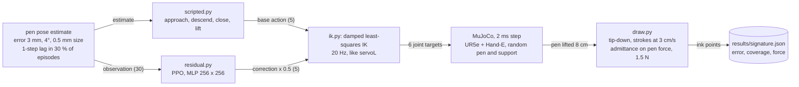
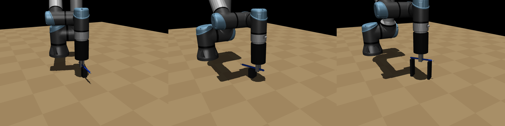
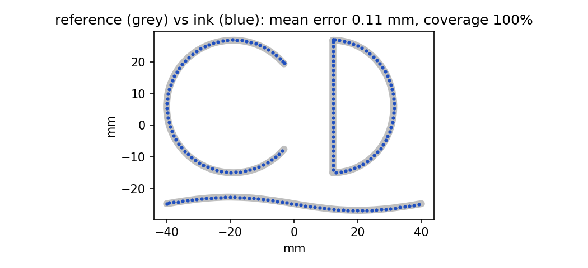

# ur-pen-signature: learned pen grasp and force-controlled signing for a UR arm, in MuJoCo

A simulated UR arm with a Robotiq Hand-E picks up a pen with a residual PPO grasp, turns it tip-down and signs with a regulated pen force. Under camera error the learned grasp succeeds in 84 % of 300 episodes against 74 % for the scripted grasp it corrects, and the signature is traced to 0.11 mm mean error at 1.51 N for a 1.5 N target. Simulation only so far; the target is the UR7e cell of the EECS 106A lab at UC Berkeley.

[Success table](results/success_table.md) · [Evaluation summaries](results) · [Simulation notes](docs/SIMULATION_NOTES.md)


*Left to right: the grasp, then the pen held tip-down drawing the monogram (MuJoCo render).*

A personal project, first commit on 1 November 2026. The split: learning where perception error makes a hand-written grasp fail, control where control is enough (the signature is a Cartesian trajectory with an admittance loop on the pen force).

## Overview

The environment randomizes the pen (12 to 16 cm long, 7 to 12 mm wide, 6 to 25 g, friction) and its support (a post, a two-post bridge or a lying bottle), and gives the controller a pen pose estimate with camera-like error. A scripted grasp acts on that estimate; PPO learns a bounded correction on top of it. After a successful lift, `draw.py` turns the pen tip-down and traces the strokes. The code is mine; the UR5e model comes from MuJoCo Menagerie (the UR7e has the same kinematics) and PPO from Stable-Baselines3.



*Grasp, then signature. The action is a TCP displacement (at most 15 mm and 0.15 rad per step) and a gripper command; the gripper part of the correction is not scaled. An episode lasts at most 160 steps (8 s).*

## Results (simulation)

Grasp success over the same 300 episode seeds with camera error and 200 with the exact pen pose, one trained policy. A success is the pen lifted 8 cm with its tip on the side away from the wrist camera. 95 % Wilson intervals in brackets.

| | Camera error (N = 300) | Bottle (N = 58) | Post (N = 145) | Bridge (N = 97) | Exact pose (N = 200) |
|---|---|---|---|---|---|
| Scripted grasp (baseline) | 74.3 % [69, 79] | 48.3 % [36, 61] | 75.2 % [68, 81] | 88.7 % [81, 94] | 99.0 % [96, 100] |
| PPO residual on the scripted grasp | **84.0 % [79, 88]** | 60.3 % [47, 72] | 88.3 % [82, 93] | 91.8 % [85, 96] | 93.5 % [89, 96] |

Source: the four `*_noisy.json` and `*_noiseless.json` files in [`results/`](results), table by [`success_table.py`](scripts/success_table.py).



- Under camera error the residual policy takes failures from 26 % to 16 %, and the two intervals do not overlap. Per support they do, so the per-support gains are not established with these sample sizes.
- With the exact pose it gives up 5.5 points (93.5 vs 99 %): it trades accuracy on a perfect estimate for tolerance to a bad one.

Signature after the learned grasp, one run: the CD monogram, 8 cm wide, at 3 cm/s. Mean distance from ink to reference 0.11 mm, 95th percentile 0.19 mm, 100 % of the reference inked, mean pen force 1.51 N for a 1.5 N target, no protective stop ([`signature.json`](results/signature.json)).



### How I checked it

- The baseline gets the same pose estimate as the policy, and its P gain was halved after it oscillated under the one-step lag, so RL is compared with a working grasp ([notes](docs/SIMULATION_NOTES.md)).
- A protective stop (25 N) ends the episode when the gripper or the pen presses on the table or a support, as on the real arm ([`config.py`](pensig/config.py)).
- Four unit tests ([`tests/test_env.py`](tests/test_env.py)): IK reaches the workspace to 1 mm and 0.5°, the pen rests on its support, the step API, and the scripted grasp lifts at least 16 of 20 pens with the exact pose.
- Lessons from the simulation, including the reward bug that made PPO from scratch learn to hover, are in [docs/SIMULATION_NOTES.md](docs/SIMULATION_NOTES.md).

## Installation

Python 3.10 or newer and MuJoCo 3.2 or newer ([`pyproject.toml`](pyproject.toml)). The evaluation summaries were produced on Windows. The UR5e model is downloaded from MuJoCo Menagerie, not redistributed.

```bash
python -m venv .venv && .venv/Scripts/activate     # source .venv/bin/activate on Linux
pip install -e ".[dev]"
python scripts/fetch_assets.py                     # sparse clone of mujoco_menagerie/universal_robots_ur5e
python -m pytest -q
```

## Usage

```bash
python scripts/evaluate.py --scripted --episodes 300 --out results/scripted_noisy.json          # success 0.743
python scripts/evaluate.py --scripted --episodes 200 --noiseless --out results/scripted_noiseless.json
python scripts/train.py --residual --timesteps 4000000 --out runs/residual
python scripts/evaluate.py --residual --policy runs/residual/final_model.zip --episodes 300 --out results/residual_noisy.json
python scripts/capture_signature.py --out examples/my_signature.json                           # sign with the mouse
python scripts/draw_signature.py --residual --policy runs/residual/final_model.zip --video results/signature.mp4
```

`draw_signature.py` uses `examples/signature_demo.json` by default and writes `results/signature.json` and `results/signature.png`. Training writes `config.json`, checkpoints and `vecnormalize.pkl` to `--out`.

## Reproducing the results and figures

| Output | Command |
|---|---|
| `results/{scripted,residual}_{noisy,noiseless}.json` | the `evaluate.py` lines above (seeds 10000 and up) |
| `results/success_table.md` and the table above | `python scripts/success_table.py` |
| `results/signature.json`, `results/signature.png` | the `draw_signature.py` line above |
| `results/preview.png`, `results/signature_frames.png` | MuJoCo renders; no script in the repository yet |

The trained policy is not in the repository (`runs/` is ignored), so the residual rows need the training run first.

## Code structure

| Component | File | Role |
|---|---|---|
| Scene | [`scene.py`](pensig/scene.py) | UR5e from Menagerie, Hand-E with the lab fingers, wrist camera mount, base 0.275 m above the table |
| Environment | [`env.py`](pensig/env.py), [`config.py`](pensig/config.py) | Gymnasium env, randomization, camera error, reward, protective stop |
| IK | [`ik.py`](pensig/ik.py) | damped least-squares IK, TCP pointing down |
| Baseline | [`scripted.py`](pensig/scripted.py) | hand-written grasp on the same estimate |
| Residual RL | [`residual.py`](pensig/residual.py) | env where PPO learns a correction on the scripted grasp |
| Signature | [`draw.py`](pensig/draw.py), [`signature.py`](pensig/signature.py) | tip-down, stroke tracing with force admittance; stroke loading and scoring |
| Scripts | [`scripts/`](scripts) | train, evaluate, draw, capture a signature, fetch assets, success table |

## Limitations

- Simulation only. Nothing has run on the UR7e yet: pen detection with the C922 camera, a touch-off to measure the tip in the gripper, `force_mode` for the pen-down phase and grooved fingers are still to do.
- One training seed and one policy: the intervals cover the episodes, not the variation between training runs.
- The UR5e model stands in for the UR7e (same kinematics, different dynamics), and the admittance loop stands in for `force_mode`.
- One signature run, on the demo strokes.
- The grasp numbers depend on a tuned MuJoCo contact model (pad friction, noslip iterations, capsule pen).

## Credits and license

- [MuJoCo](https://github.com/google-deepmind/mujoco) (Apache-2.0) and the UR5e model of [MuJoCo Menagerie](https://github.com/google-deepmind/mujoco_menagerie) (BSD-3), downloaded by `scripts/fetch_assets.py`.
- [Stable-Baselines3](https://github.com/DLR-RM/stable-baselines3) (MIT) for PPO, [Gymnasium](https://github.com/Farama-Foundation/Gymnasium) (MIT).
- The lab cell geometry (pedestal height, Hand-E fingers, camera mount) follows the EECS 106A lab setup.

MIT license ([LICENSE](LICENSE)). Citation metadata: [CITATION.cff](CITATION.cff).
