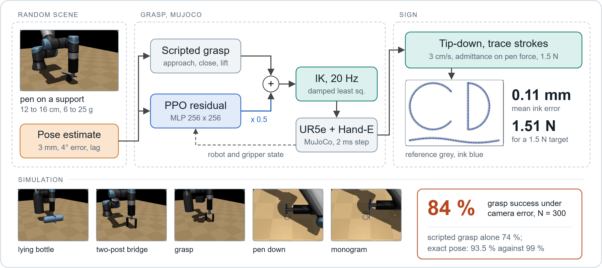
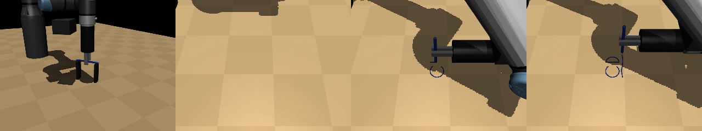

# ur-pen-signature: learned pen grasp and force-controlled signing for a UR arm

[Success table](results/success_table.md) · [Evaluation summaries](results) · [Method details and reproduction](docs/REPRODUCING.md) · [Simulation notes](docs/SIMULATION_NOTES.md)

<!-- real-arm video here -->



A UR arm with a Robotiq Hand-E picks up a pen with a residual PPO grasp, turns it tip-down and signs with a regulated pen force. In MuJoCo, under camera error, the learned grasp succeeds in 84 % of 300 episodes against 74 % for the scripted grasp it corrects, and the signature is traced to 0.11 mm mean error at 1.51 N for a 1.5 N target. The target cell is the UR7e of the EECS 106A lab at UC Berkeley.

## Method

Learning where perception error makes a hand-written grasp fail, control where control is enough. The environment randomizes the pen and its support (post, two-post bridge, lying bottle) and gives the controller a pen pose estimate with camera-like error (3 mm, 4°, sometimes one step late). A scripted grasp acts on that estimate; PPO (MLP 256 x 256) learns a bounded correction on top of it, and damped least-squares IK turns the sum into joint targets at 20 Hz. After the lift, `draw.py` turns the pen tip-down and traces the strokes as a Cartesian trajectory with an admittance loop on the pen force. Details: [docs/REPRODUCING.md](docs/REPRODUCING.md).

A personal project, first commit on 1 November 2026. The code is mine; the UR5e model comes from MuJoCo Menagerie (the UR7e has the same kinematics) and PPO from Stable-Baselines3.

## Results (simulation)

Grasp success over the same 300 episode seeds with camera error and 200 with the exact pen pose, one trained policy. 95 % Wilson intervals in brackets.

| | Camera error (N = 300) | Bottle (N = 58) | Post (N = 145) | Bridge (N = 97) | Exact pose (N = 200) |
|---|---|---|---|---|---|
| Scripted grasp (baseline) | 74.3 % [69, 79] | 48.3 % [36, 61] | 75.2 % [68, 81] | 88.7 % [81, 94] | 99.0 % [96, 100] |
| PPO residual on the scripted grasp | **84.0 % [79, 88]** | 60.3 % [47, 72] | 88.3 % [82, 93] | 91.8 % [85, 96] | 93.5 % [89, 96] |

Source: the four `*_noisy.json` and `*_noiseless.json` files in [`results/`](results), table by [`success_table.py`](scripts/success_table.py). Under camera error the residual takes failures from 26 % to 16 %; with the exact pose it gives up 5.5 points, trading accuracy on a perfect estimate for tolerance to a bad one.

Signature after the learned grasp, one run: the CD monogram, 8 cm wide, at 3 cm/s. Mean ink error 0.11 mm, 95th percentile 0.19 mm, 100 % of the reference inked, mean pen force 1.51 N, no protective stop ([`signature.json`](results/signature.json)).



## Install and quick start

Python 3.10 or newer and MuJoCo 3.2 or newer ([`pyproject.toml`](pyproject.toml)). The UR5e model is downloaded from MuJoCo Menagerie, not redistributed.

```bash
python -m venv .venv && .venv/Scripts/activate     # source .venv/bin/activate on Linux
pip install -e ".[dev]"
python scripts/fetch_assets.py                     # sparse clone of mujoco_menagerie/universal_robots_ur5e
python -m pytest -q
python scripts/evaluate.py --scripted --episodes 300 --out results/scripted_noisy.json    # success 0.743
python scripts/train.py --residual --timesteps 4000000 --out runs/residual
python scripts/draw_signature.py --residual --policy runs/residual/final_model.zip
```

All evaluation, signature-capture and reproduction commands: [docs/REPRODUCING.md](docs/REPRODUCING.md).

## Code structure

| Path | Role |
|---|---|
| [`scene.py`](pensig/scene.py) | UR5e from Menagerie, Hand-E with the lab fingers, wrist camera mount, lab pedestal height |
| [`env.py`](pensig/env.py), [`config.py`](pensig/config.py) | Gymnasium env, randomization, camera error, reward, protective stop |
| [`ik.py`](pensig/ik.py), [`scripted.py`](pensig/scripted.py) | damped least-squares IK; hand-written grasp on the same estimate |
| [`residual.py`](pensig/residual.py) | env where PPO learns a correction on the scripted grasp |
| [`draw.py`](pensig/draw.py), [`signature.py`](pensig/signature.py) | tip-down, stroke tracing with force admittance; stroke loading and scoring |
| [`scripts/`](scripts) | train, evaluate, draw, capture a signature, fetch assets, success table |

## Limitations

- The success rates and the signature error are measured in simulation; the hardware steps (pen detection with the C922 camera, a tip touch-off, `force_mode` for the pen-down phase) are not evaluated here.
- One training seed and one policy: the intervals cover the episodes, not the variation between training runs.
- The UR5e model stands in for the UR7e (same kinematics, different dynamics), and the admittance loop stands in for `force_mode`.
- One signature run, on the demo strokes.
- The grasp numbers depend on a tuned MuJoCo contact model (pad friction, noslip iterations, capsule pen).

## Credits and license

[MuJoCo](https://github.com/google-deepmind/mujoco) and the UR5e model of [MuJoCo Menagerie](https://github.com/google-deepmind/mujoco_menagerie), downloaded by `scripts/fetch_assets.py`; [Stable-Baselines3](https://github.com/DLR-RM/stable-baselines3) for PPO; [Gymnasium](https://github.com/Farama-Foundation/Gymnasium). The lab cell geometry (pedestal height, Hand-E fingers, camera mount) follows the EECS 106A lab setup.

MIT license ([LICENSE](LICENSE)). Citation metadata: [CITATION.cff](CITATION.cff).
