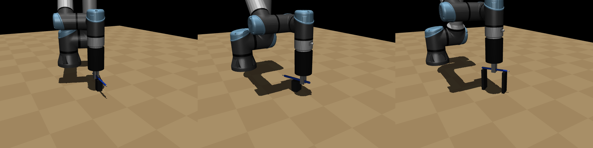
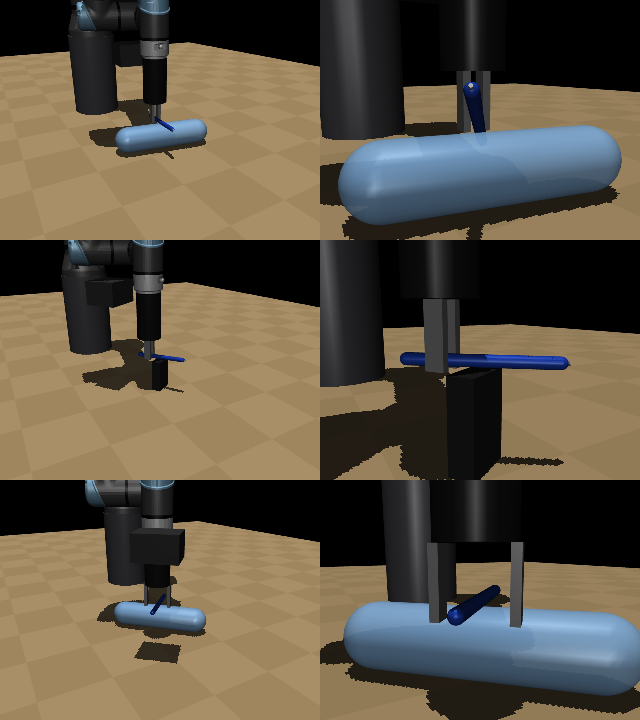

# Method details, checks and reproduction

Back to the [README](../README.md). Lessons from the simulation: [SIMULATION_NOTES.md](SIMULATION_NOTES.md).

## Environment and action

The environment randomizes the pen (12 to 16 cm long, 7 to 12 mm wide, 6 to 25 g, friction) and its support (a post, a two-post bridge or a lying bottle). The controller gets a pen pose estimate with camera-like error: 3 mm, 4°, 0.5 mm on the size, and a one-step lag in 30 % of episodes ([`config.py`](../pensig/config.py)).

The scripted grasp ([`scripted.py`](../pensig/scripted.py)) approaches, descends, closes and lifts on that estimate. The residual policy ([`residual.py`](../pensig/residual.py)) sees a 30-dimensional observation and outputs a correction that is scaled by 0.5 and added to the scripted action; the gripper part of the correction is not scaled. The action is a TCP displacement (at most 15 mm and 0.15 rad per step) and a gripper command, turned into 6 joint targets by damped least-squares IK at 20 Hz, like `servoL` ([`ik.py`](../pensig/ik.py)). MuJoCo steps at 2 ms; an episode lasts at most 160 steps (8 s). A success is the pen lifted 8 cm with its tip on the side away from the wrist camera.

After a successful lift, [`draw.py`](../pensig/draw.py) turns the pen tip-down and traces the strokes at 3 cm/s with an admittance loop on the pen force (1.5 N target), and writes the ink points to `results/signature.json`.

## How I checked it

- The baseline gets the same pose estimate as the policy, and its P gain was halved after it oscillated under the one-step lag, so RL is compared with a working grasp ([notes](SIMULATION_NOTES.md)).
- A protective stop (25 N) ends the episode when the gripper or the pen presses on the table or a support, as on the real arm ([`config.py`](../pensig/config.py)).
- Four unit tests ([`tests/test_env.py`](../tests/test_env.py)): IK reaches the workspace to 1 mm and 0.5°, the pen rests on its support, the step API, and the scripted grasp lifts at least 16 of 20 pens with the exact pose.
- Under camera error the two overall intervals do not overlap; per support they do, so the per-support gains are not established with these sample sizes.





## Commands

```bash
python scripts/evaluate.py --scripted --episodes 300 --out results/scripted_noisy.json          # success 0.743
python scripts/evaluate.py --scripted --episodes 200 --noiseless --out results/scripted_noiseless.json
python scripts/train.py --residual --timesteps 4000000 --out runs/residual
python scripts/evaluate.py --residual --policy runs/residual/final_model.zip --episodes 300 --out results/residual_noisy.json
python scripts/capture_signature.py --out examples/my_signature.json                           # sign with the mouse
python scripts/draw_signature.py --residual --policy runs/residual/final_model.zip --video results/signature.mp4
```

`draw_signature.py` uses `examples/signature_demo.json` by default and writes `results/signature.json` and `results/signature.png`. Training writes `config.json`, checkpoints and `vecnormalize.pkl` to `--out`.

| Output | Command |
|---|---|
| `results/{scripted,residual}_{noisy,noiseless}.json` | the `evaluate.py` lines above (seeds 10000 and up) |
| `results/success_table.md` | `python scripts/success_table.py` |
| `results/signature.json`, `results/signature.png` | the `draw_signature.py` line above |
| `results/preview.png`, `results/signature_frames.png`, `results/stop_cases.png` | MuJoCo renders; no script in the repository yet |
| `docs/figures/overview.png` | hand-written `overview.svg` from crops of `results/` images, rendered at 2x with headless Chrome |

The trained policy is not in the repository (`runs/` is ignored), so the residual rows need the training run first.
